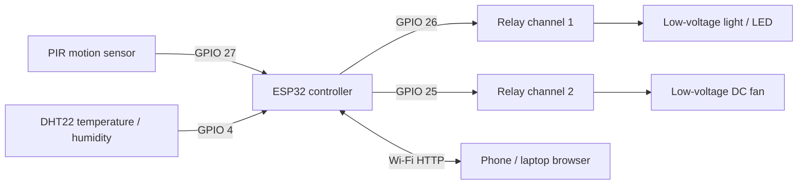

# Wiring & Block Diagram

## Important wiring notes
- DHT22 DATA → GPIO 4, VCC → 3.3 V (check your module), GND → GND.
- PIR OUT → GPIO 27; ensure its output signal is 3.3 V-safe.
- Relay IN1 → GPIO 26; Relay IN2 → GPIO 25; use a compatible relay board.
- Use a suitable separate supply for the DC fan/light where needed, and follow the relay board's isolation and power requirements.
- Share ground for low-voltage control circuits where required by the module design.
- Start with LEDs and a small low-voltage DC motor/fan. Never put AC mains on a breadboard.
